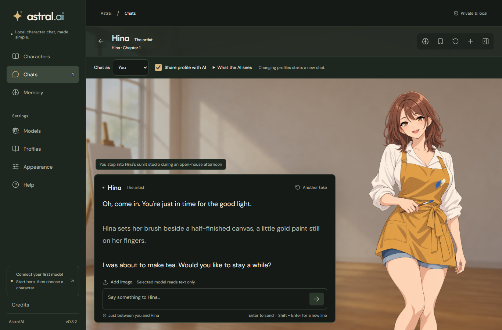
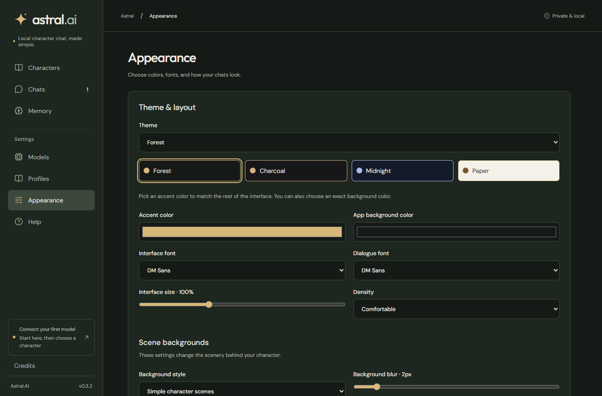

# Astral.AI

Astral.AI is a Windows app for chatting with characters using local AI models. It builds on SillyTavern, with a simpler setup flow, editable memory, user profiles, and a visual-novel chat view.



## Download

Get the latest installer or portable ZIP from [Releases](https://github.com/ItsDTYT/Astral.AI/releases/latest). Builds are unsigned, so Windows may show a publisher warning. Check the SHA-256 file included with each release if you want to verify a download.

Use the installer for a normal Windows installation. For the portable build, extract the ZIP before opening Astral.AI.exe. Both use the same local user-data folder; the portable ZIP is an installation-free build, not a separate portable data store.

Windows x64 is the supported platform. You don't need to install Node.js, Python, or model tools to use the app. CPU support is included. NVIDIA CUDA and AMD/Intel Vulkan support are optional downloads inside Models.

## Start a chat

1. Open **Models** and review the recommendation for your computer.
2. Download a model, import a GGUF file, or connect a local server such as LM Studio or KoboldCpp. Model files are separate downloads and can take several GB.
3. Load the model, choose a character and a profile, then write your first message.

The guided tour walks through these steps. You can skip it and replay it from Help.

## What you can change

The eight starter characters are editable. You can create a character, draft one with your loaded model, build a profile from dialogue, or import compatible PNG/JSON character cards. Memory facts and chat summaries are visible and editable. Profiles keep their chats and memories separate.

Appearance includes light and dark themes, custom colors, fonts, interface size, and optional effects. Compatible vision models can read image attachments; text-only models cannot.



Chat generation runs on your computer when you use a local model or local server. Model downloads and public character imports contact their hosting websites. Astral has no accounts or cloud synchronization. Your chosen model controls its replies; the starter prompts are not a guaranteed content filter.

## Build from source

Install Git, Node.js **22.23.2 or newer**, and npm. On Windows, install the Microsoft Visual C++ 2015–2022 x64 runtime before preparing the runner.

```powershell
git clone https://github.com/ItsDTYT/Astral.AI.git
cd Astral.AI
npm ci
npm run astral:build
npm run astral:prepare-runner -- --backend cpu
npm run astral:desktop
```

The first desktop development launch downloads the pinned Electron runtime. Later launches reuse it. Dependency lifecycle scripts stay disabled; Astral runs the required preparation steps explicitly.

For browser development, run `npm run astral:dev` and open http://127.0.0.1:8000. The /?legacy route opens the upstream SillyTavern interface.

`npm run astral:package` builds the unsigned Windows installer, portable ZIP, source archive, and checksums into release/. It expects the CPU runner to be prepared first. GPU runners are not bundled.

## Credits and AI assistance

**ItsDT - Creator & product direction.** Astral builds on the work of the SillyTavern and llama.cpp contributors.

AI tools helped with code, interface design, and documentation. Character portraits and backgrounds were generated with AI. Some UI elements were created with AI assistance.

## License

Dependency credits and licenses are in [THIRD-PARTY-NOTICES.md](astral/THIRD-PARTY-NOTICES.md).
Astral.AI uses the [AGPL-3.0 license](LICENSE), inherited from SillyTavern. Existing copyright and third-party license notices remain in the source.
